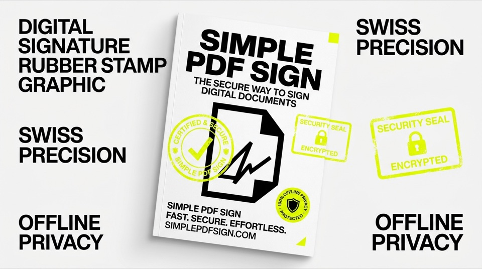

# Simple PDF Sign — 100% Private Client-Side PDF Signing & Stamping

<p align="center">
  
</p>

> **Sign, stamp, and export PDF documents in seconds directly in your browser.**  
> Zero accounts. Zero cloud uploads. Zero subscriptions. 100% client-side privacy.

[](https://emaf205.com/ideas/simple-pdf-sign/)
[](https://youtu.be/_kEl7B9Udy4)
[](https://github.com/emaf205/SIMPLE-PDF-SIGN)
[](LICENSE)

---

## ✦ The Genesis & Why This Exists

Every professional encounters this routine annoyance: you receive a contract, an invoice, a NDA, or a lease agreement. You just need to paste your handwritten signature PNG onto page 3, add today's date, and send it back.

What are your typical options?
1. **Commercial Cloud PDF SaaS**: Services like Smallpdf or Adobe Online require creating an account, impose strict daily document quotas, demand expensive subscriptions, and most alarmingly: **require uploading your confidential legal and financial documents to their cloud servers**.
2. **Heavyweight Desktop Software**: Installing bloated 1GB software suites that constantly prompt for cloud logins.

I built **Simple PDF Sign** out of personal necessity: a clean, instantaneous web utility that allows anyone to drop a PDF, paste a signature or company stamp, drag and resize it, and download the finished document in under 15 seconds.

**Your files never leave your device.** Every byte of PDF manipulation happens strictly inside your browser's local sandbox memory.

---

## ✦ Video Walkthrough

Watch the complete workflow in action:

[](https://youtu.be/_kEl7B9Udy4)

---

## ✦ How It Works in 4 Steps

1. **Drop your PDF**: Drag any multi-page PDF into the browser viewport.
2. **Add Signature or Stamp**: Upload a transparent PNG/JPEG signature, digital company seal, or custom logo.
3. **Position & Scale**: Move the signature freely across any page, adjust opacity, rotate, or resize to fit signature lines precisely.
4. **Instant Export**: Download the newly flattened, production-ready PDF file immediately.

---

## ✦ Technical Highlights

- **🔒 Absolute Client-Side Privacy**:
  - Leverages browser-native File API and Canvas rendering.
  - No server backend. Works completely offline once loaded.
- **📄 Multi-Page Document Support**:
  - Smooth page navigation drawer for agreements of any length.
  - Apply distinct signatures or stamps across different pages.
- **⚡ Zero Telemetry & Zero Bloat**:
  - No cookies, no tracking pixels, no advertising scripts.
  - Lightweight and responsive on mobile tablets and desktop workstations.

---

## ✦ Quickstart & Offline Usage

```bash
# Clone the repository
git clone https://github.com/emaf205/SIMPLE-PDF-SIGN.git
cd SIMPLE-PDF-SIGN

# Open the standalone tool directly in your browser
open index.html
```

Or access the hosted version anytime at:  
👉 **[https://emaf205.com/ideas/simple-pdf-sign/](https://emaf205.com/ideas/simple-pdf-sign/)**

---

## ✦ Author & Credits

Engineered by **[Emanuele BDC](https://emaf205.com)** in Milan.  
Built for professionals who care about privacy, speed, and digital sovereignty.

Distributed under the **MIT License**. Free for personal and commercial use.
